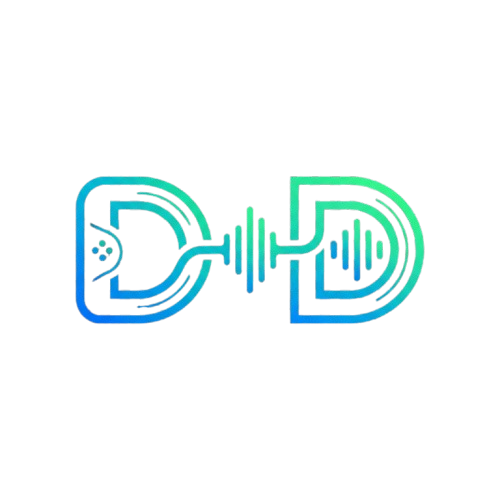
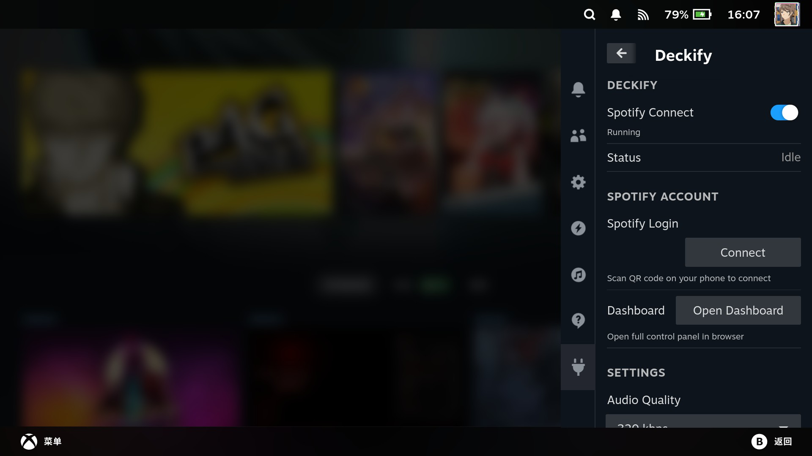
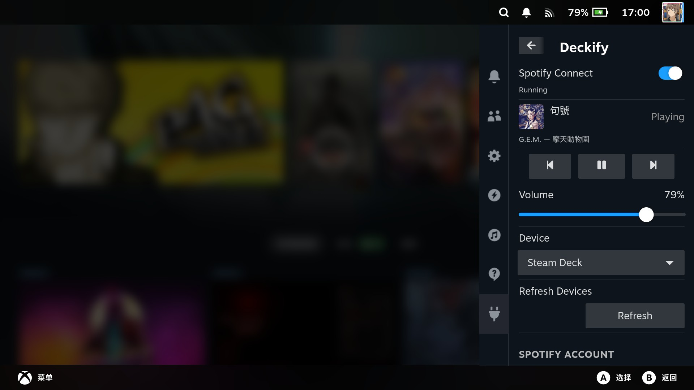
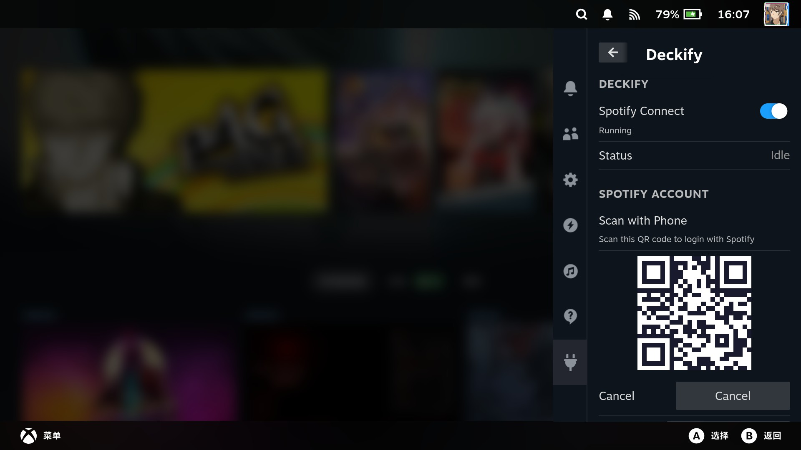
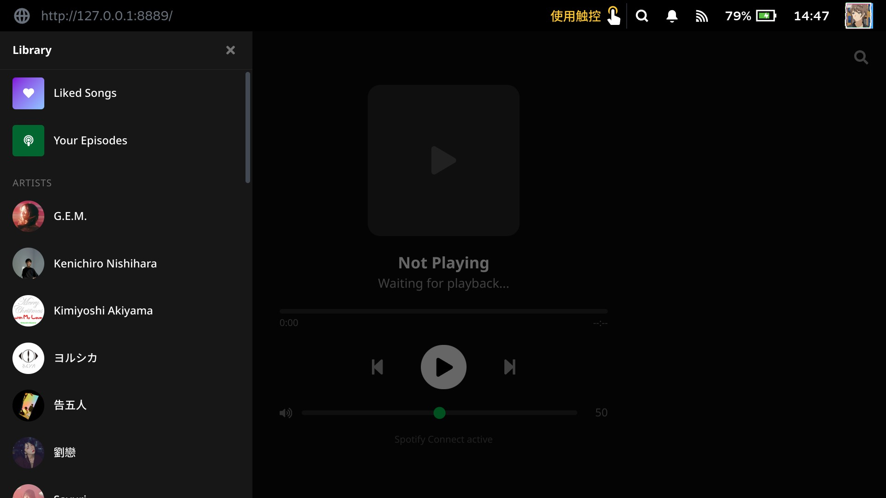
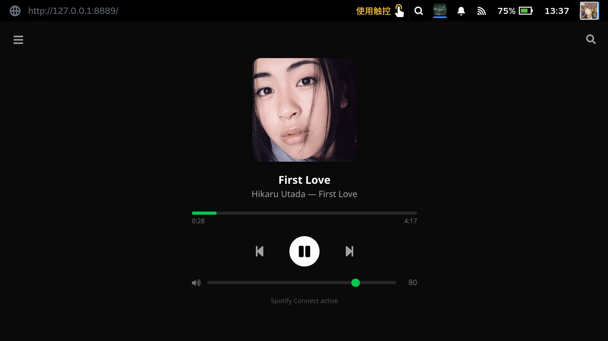
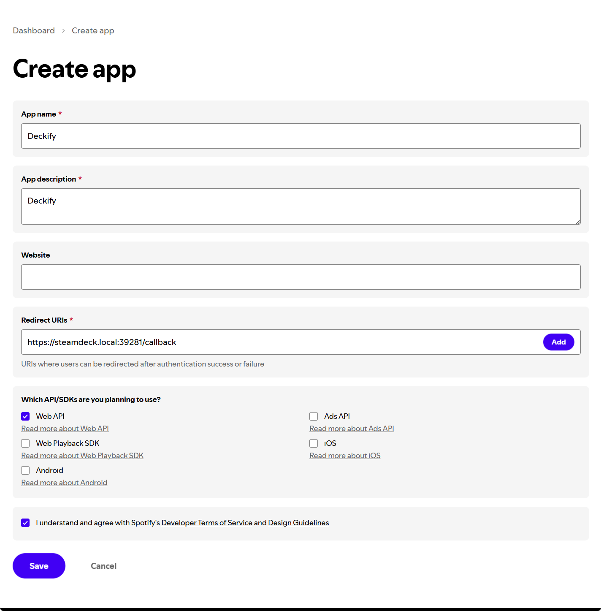

<p align="center">
  
</p>

<h1 align="center">Deckify</h1>

<p align="center">Steam Deck 上的 Spotify 音乐管理插件，基于 <a href="https://github.com/SteamDeckHomebrew/decky-loader">Decky Loader</a> 构建。</p>

<p align="center"><a href="README.md">English</a> | 中文 | <a href="README_JP.md">日本語</a></p>

## 功能

- **Spotify Connect** — 通过 [librespot](https://github.com/librespot-org/librespot) 使 Steam Deck 成为 Spotify Connect 设备
- **播放控制** — 在快捷访问面板中控制播放/暂停、上一首、下一首、音量
- **设备管理** — 查看并在 Spotify Connect 设备之间切换播放
- **Web 仪表盘** — 在 Steam 浏览器中提供完整的播放界面和曲库浏览
- **OAuth (PKCE)** — 通过二维码安全登录 Spotify，无需额外服务器

## 截图

| 快捷访问面板 | 播放控制 |
|:--:|:--:|
|  |  |

| 二维码登录 | 仪表盘曲库 |
|:--:|:--:|
|  |  |

| Web 仪表盘 |
|:--:|
|  |

## 安装

需要在 Steam Deck 上预先安装 [Decky Loader](https://github.com/SteamDeckHomebrew/decky-loader)。

```bash
curl -fsSL https://deckify.advinn.co/install.sh | sh
```

卸载：

```bash
curl -fsSL https://deckify.advinn.co/uninstall.sh | sh
```

默认保留配置和数据，方便重新安装。如需同时删除登录信息、配置、缓存、证书和日志（含旧版存储位置），使用：

```bash
curl -fsSL https://deckify.advinn.co/uninstall.sh | sh -s -- --purge
```

插件已移除后仍可执行 `--purge`。它只清理本机 Deckify 数据，不删除另行制作的备份，也不会撤销 Spotify 账户中的应用授权。两种卸载模式执行时都会短暂停止并启动 Decky Loader。

在 Deckify 的 **Settings → Device name** 中填写 Spotify Connect 显示名称并保存；正在运行时点击 **Restart Now** 应用。留空则使用系统主机名。已有自定义名称会保留，旧版自动填写的“Steam Deck”会改为使用主机名。修改显示名称不会改变系统主机名或 OAuth 回调地址。

## Spotify 账户设置

每位用户需要在 [developer.spotify.com](https://developer.spotify.com) 注册一个 Spotify App：

1. 创建新应用，填写以下信息：
   - **App name:** `Deckify`
   - **App description:** `Deckify`
   - **Redirect URI：**复制 Deckify Spotify 登录页面显示的完整地址（主机名为小写 `steamdeck` 时，地址为 `https://steamdeck.local:39281/callback`）
   - 勾选 **Web API**

   

2. 复制 **Client ID**，在插件的 Spotify 登录流程中输入
3. 扫描二维码时，浏览器可能会显示证书安全警告——这是正常现象（本地 HTTPS 使用自签名证书），点击继续访问即可
4. Redirect URI 必须完全一致，包括主机名大小写。即使你没有修改主机名，也请以登录页面显示的地址为准。
5. Spotify 开发者模式下，每个 Client ID 限制 5 个授权用户

> **注意：** 运行 OpenHarmony 的设备由于缺少 mDNS / Zeroconf 支持，暂时无法使用本插件。

## 已知问题

- **唤醒后设备列表延迟** — Steam Deck 从休眠唤醒后，librespot 需要几秒钟重启并重新注册到 Spotify。在此期间设备列表可能只显示其他设备，稍等片刻刷新即可。
- **设备切换未即时更新** — 在下拉菜单中切换设备后，选中状态可能短暂停留在之前的设备上。这是 Spotify API 传播延迟导致的，稍等即可更新。

## 开发

### 环境要求

- Node.js v16.14+
- pnpm v9

### 构建

```bash
pnpm i
pnpm run build    # 构建插件前端 + 仪表盘
```

### 部署到 Steam Deck

```bash
./deploy.sh               # 使用 .vscode/settings.json 默认配置
./deploy.sh --build        # 部署前先构建
./deploy.sh deck@10.0.0.5  # 指定目标地址
```

## 致谢

- [librespot](https://github.com/librespot-org/librespot) (MIT) — 开源 Spotify 客户端库
- [Decky Loader](https://github.com/SteamDeckHomebrew/decky-loader) — Steam Deck 插件框架
- [@decky/ui](https://github.com/SteamDeckHomebrew/decky-frontend-lib) — Steam 原生 React 组件库

## 许可证

GPL-3.0
